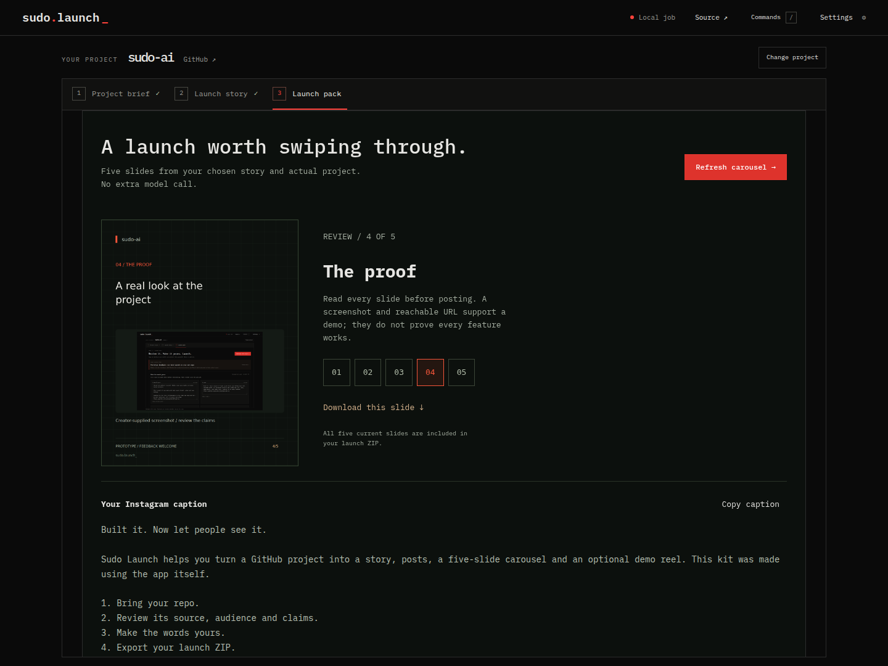

# Sudo Launch

**Turn your GitHub project into a launch people understand.**

[Try the live demo](https://sudo-launch.onrender.com) · open your own public GitHub project using the owner's configured providers during the evaluation. Run locally below to use your own keys.

Sudo Launch helps student and solo developers explain, demonstrate and share projects that would otherwise stay in a repo. Paste a GitHub URL or discover projects on your profile, review concrete source-backed suggestions, confirm the audience, and choose a launch story. Get saved editable LinkedIn/X/Instagram drafts, a five-slide carousel, a sharing plan and an optional 25-second video in one ZIP.



## What it does

- Reads selected source at a pinned commit across web apps, Python tools, libraries, workspaces and prototypes. It never installs or executes the repository.
- Uses repository context and your audience/goal to write launch stories, without readiness checklists or deployment gates.
- Writes two evidence-cited launch stories using Gemma through AI Studio, Nebius GLM, or a locally configured compatible model. You confirm the brief and review findings first.
- Records an approved public demo with bounded AI-selected interactions or your exact click/scroll steps, or accepts uploaded footage and screenshots. Videos without product visuals use a branded explainer; raw code is never shown as demo footage.
- Composes portrait 1080×1920 or landscape 1280×720 MP4s using a reviewed storyboard, optional ElevenLabs narration/music, and captions aligned to the generated voice. Exports a poster and SRT too.
- Saves reviewed copy edits and composes five 1080×1350 Instagram slides from the chosen story and optional product screenshot.
- Downloads one ZIP with current copy, available media, carousel, storyboard and execution receipt. A future launch date adds manual calendar reminders.
- Keeps session-owned jobs, edits and media in local SQLite across restarts. You review and publish posts yourself.

Web apps need a reachable public demo or an explicit prototype launch. CLI/library launches can use source and usage examples. HTTP checks and footage do not certify every feature works.

## Run locally

Requires Node.js 22.13+ (built-in SQLite), npm, and FFmpeg/ffprobe for media. Tested on Node 22.22.

```bash
npm install
cp .env.example .env  # only if you do not already have .env
npm run setup:browser
npm run dev
```

Open http://localhost:5173. Add your own provider credentials to the ignored `.env`, then restart the API. Source inspection and manual briefs work without a model key; generation requires a configured provider. No API keys are entered in the browser.

The default app runs on localhost. Jobs, reviewed edits and media persist in ignored `.local/sudo-launch.sqlite` for seven days (`SUDO_RETENTION_DAYS`); deletion removes the job and its media. The database has owner-only file permissions and contains project content, not provider keys or GitHub tokens. Keep the same browser cookie to resume your jobs. Interrupted operations require an explicit retry; paid calls never retry automatically.

## Host a demo on Render

The included [Render Blueprint](render.yaml) builds a Docker web service with Chromium, FFmpeg and a persistent SQLite disk. It selects **1 CPU / 2 GB RAM at $25/month**, billed proportionally to running time, plus a 1 GB disk at $0.25/month. Render's free web service has 512 MB RAM; the advertised 25 MB belongs to its Key Value service. The larger web instance is recommended for video capture and rendering.

Connect this repository through Render's **New → Blueprint** flow, supply the Nebius/ElevenLabs credentials when prompted, and keep automatic deployments disabled until you choose to update. The Blueprint sets `SUDO_DEMO_ACCESS=public`: visitors can open the app and use their own repos without a site password, spending the owner's configured provider quota. To restrict access, set `SUDO_DEMO_ACCESS=password`; the generated `SUDO_DEMO_PASSWORD` and username `judge` then enable HTTPS Basic authentication. Set a separate GitHub OAuth callback to `https://YOUR-SERVICE.onrender.com/api/auth/github/callback` if you enable sign-in. Public repo discovery works without OAuth.

Hosted mode allows one operation at a time. Video composition closes Chromium before FFmpeg encoding to reduce peak memory. Each visitor's jobs and media belong to their browser session and use the persistent disk; your local database and prepared demo files are excluded from the image. Visitors cannot enter provider keys on the hosted site. After evaluation, revoke the provider keys to stop new paid generations, or switch back to password access. A hosted product accepting users' own keys still requires encrypted credentials and isolated workers. See [hosting details](docs/hosting.md).

## Development and demo

```bash
npm run build
npm test
npm run test:ui
```

See [setup and API](docs/development.md), [evaluation demo guide](docs/demo-guide.md), and [remaining account tasks](todo.md). Product specifications: [overview](docs/hacktoberfest/ideation.md), [PRD](docs/hacktoberfest/prd.md), [UI/UX](docs/hacktoberfest/ui-ux.md), [model harness](docs/hacktoberfest/model-harness.md).

## Integrations and reuse

React/TypeScript/Vite, Node/Express, GitHub, selectable model inference, ElevenLabs, Playwright and FFmpeg. The storyboard/composition structure adapts [Brag](https://github.com/latent-spaces/brag); see [third-party notices](THIRD_PARTY_NOTICES.md). Agent-Reach research is being evaluated and is not an implemented integration. Calendar reminders do not automatically publish social posts.

Sudo Launch is licensed under [GNU GPL v3.0](LICENSE) (GPL-3.0-only), copyright © 2026 Alok Raj Shahi. Third-party notices retain their original licenses. Source is available at [sudo-ai](https://github.com/alokrajshahi04/sudo-ai). Event research is retained in the [context index](docs/hacktoberfest/README.md).
