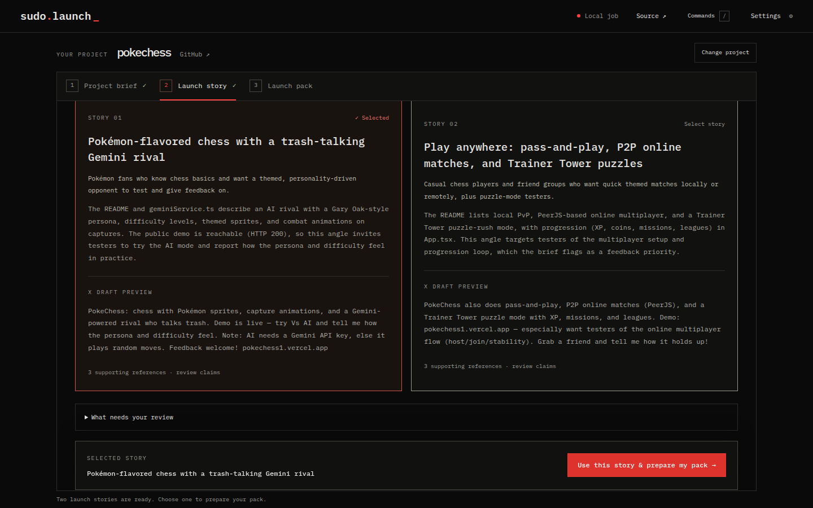

# Sudo Launch

**Turn your GitHub project into a launch people understand.**

Sudo Launch helps student and solo developers explain, demonstrate and share projects that would otherwise stay in a repo. Paste a GitHub URL or discover projects on your profile, review concrete source-backed suggestions, confirm the audience, and choose a launch story. Get editable LinkedIn/X drafts, a sharing plan and an optional 25-second video.



## What it does

- Reads selected source at a pinned commit across web apps, Python tools, libraries, workspaces and prototypes. It never installs or executes the repository.
- Combines deterministic readiness checks with model suggestions tied to actual source quotations. Provides a coding-agent handoff for fixes you choose to make elsewhere.
- Writes two evidence-cited launch stories using Gemma through AI Studio, Nebius GLM, or a locally configured compatible model. You confirm the brief and review findings first.
- Records an approved public deployed URL with explicit click/scroll steps, or accepts your recording and screenshots.
- Composes portrait 1080×1920 or landscape 1280×720 MP4s using a reviewed storyboard, optional ElevenLabs narration/music, and captions aligned to the generated voice. Exports a poster and SRT too.
- Exports a Markdown launch kit, execution receipt and dated calendar reminders. You review and publish posts yourself.

Web apps need a reachable public demo or an explicit prototype launch. CLI/library launches can use source and usage examples. HTTP checks and footage do not certify every feature works.

## Run locally

Requires Node.js 22+, npm, and FFmpeg/ffprobe for media.

```bash
npm install
cp .env.example .env  # only if you do not already have .env
npm run setup:browser
npm run dev
```

Open http://localhost:5173. Add your own provider credentials to the ignored `.env`, then restart the API. Source inspection and manual briefs work without a model key; generation requires a configured provider. No API keys are entered in the browser.

The current app runs on localhost with session-owned jobs held in memory. Jobs/media expire after one hour and disappear on server restart, so download useful outputs. A public hosted BYOK service is a future release requiring durable storage, authentication and encrypted per-user credentials.

## Development and demo

```bash
npm run build
npm test
npm run test:ui
```

See [setup and API](docs/development.md), [evaluation demo guide](docs/demo-guide.md), and [remaining account tasks](todo.md). Product specifications: [overview](docs/hacktoberfest/ideation.md), [PRD](docs/hacktoberfest/prd.md), [UI/UX](docs/hacktoberfest/ui-ux.md), [model harness](docs/hacktoberfest/model-harness.md).

## Integrations and reuse

React/TypeScript/Vite, Node/Express, GitHub, selectable model inference, ElevenLabs, Playwright and FFmpeg. The storyboard/composition structure adapts [Brag](https://github.com/latent-spaces/brag); see [third-party notices](THIRD_PARTY_NOTICES.md). Agent-Reach research is being evaluated and is not an implemented integration. Calendar reminders do not automatically publish social posts.

Source is public at [sudo-ai](https://github.com/alokrajshahi04/sudo-ai). The project license is still an owner decision; public availability alone does not grant an open-source license. Event research is retained in the [context index](docs/hacktoberfest/README.md).
